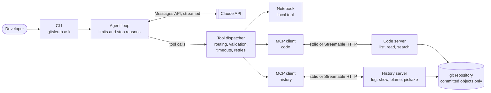

# GitSleuth

**A Claude agent that answers questions about a git repository's history.** Ask "when did invoice rounding break, and why?" and it plans an investigation, then works through blame, pickaxe search, commit diffs and the code itself. Its answer comes with findings tied to the commits behind them.

The project exists to show the parts of an agentic system working together on a real problem: two **MCP servers**, an **MCP client**, a **tool dispatcher** and an **agent loop**.

> Status: source project with automated tests. The agent has not yet been run against the real Claude API; see [What has been verified](#what-has-been-verified).

---

## Why this problem

Questions about history are hard to answer with one search. You follow a line to a commit, read its diff, search for when a string first appeared, and repeat. The next step depends on the last result, which is what an agent loop is for. The tools are also real and need no external services: they run git against a repository you already have.

## Architecture



| Component | File | What it does |
| --- | --- | --- |
| MCP servers | [`servers/code_server.py`](src/gitsleuth/servers/code_server.py), [`servers/history_server.py`](src/gitsleuth/servers/history_server.py) | Seven read-only tools, built with the official MCP Python SDK |
| MCP client | [`mcp_client.py`](src/gitsleuth/mcp_client.py) | Connects over stdio or Streamable HTTP, discovers tools, and reopens the session after a crash |
| Tool dispatcher | [`dispatcher.py`](src/gitsleuth/dispatcher.py) | Routes each call to an MCP server or local tool, validates input against the tool's JSON Schema, and handles timeouts and retries |
| Agent loop | [`agent.py`](src/gitsleuth/agent.py), [`model.py`](src/gitsleuth/model.py) | Drives Claude, feeds results back, and stops on limits with a clear reason |
| Local tool | [`notebook.py`](src/gitsleuth/notebook.py) | Records findings, and refuses a commit hash that no earlier tool result contained |

More detail: [architecture](docs/architecture.md), [sequence of one agent run](docs/diagrams/sequence-agent-run.md), [class diagram](docs/diagrams/class-diagram.md), [dispatcher decisions](docs/diagrams/dispatch-decisions.md), and the decision records in [`docs/adr/`](docs/adr/).

## Tools

The model sees each tool as `<server>__<tool>`.

| Tool | Purpose |
| --- | --- |
| `code__list_files` | Tracked files at a revision |
| `code__read_file` | Committed lines of a file at a revision, paged |
| `code__search_code` | Literal or regex search at a revision (`git grep`) |
| `history__git_log` | Commits filtered by path, message text or date |
| `history__show_commit` | A commit's message, changed files and patch |
| `history__blame_lines` | Which commit last changed each line in a range |
| `history__find_string_changes` | Commits that added or removed a string (`git log -S`) |
| `notes__record_finding` | Local tool: record a claim with the commits behind it |

## Run it

Requires Python 3.11+ and git.

```bash
python -m venv .venv
```

```bash
source .venv/bin/activate
```

On Windows, activate with `.venv\Scripts\activate` instead.

```bash
pip install -e ".[dev]"
```

These commands use the real MCP servers and make no model calls:

```bash
gitsleuth tools --repo .
```

```bash
gitsleuth call --repo . history__git_log '{"limit": 5}'
```

To run the agent, set `ANTHROPIC_API_KEY` (or use another credential the Anthropic SDK resolves). **This makes billed API calls.**

```bash
gitsleuth ask --repo . "Why does the MCP client run a supervisor task?"
```

`--max-steps`, `--max-tool-calls`, `--max-total-tokens` and `--deadline` set the run's limits. `--verbose` writes one JSON event per line to stderr. `--json` prints the whole result.

To serve the tools over HTTP instead of as subprocesses:

```bash
gitsleuth-server code --repo . --transport streamable-http --port 8101
```

```bash
gitsleuth-server history --repo . --transport streamable-http --port 8102
```

```bash
gitsleuth tools --code-url http://127.0.0.1:8101/mcp --history-url http://127.0.0.1:8102/mcp
```

The HTTP servers have no authentication, so keep them on localhost. They bind to `127.0.0.1` unless `--host` says otherwise.

## Test it

```bash
pytest -q
```

No test calls the Claude API, and no secrets are needed.

| Test file | What is real | What is scripted |
| --- | --- | --- |
| `test_mcp_stdio.py` | Client, both servers as subprocesses, stdio transport, git | Nothing |
| `test_mcp_http.py` | Client, server processes, Streamable HTTP, a killed and restarted server | Nothing |
| `test_reliability.py` | Client, dispatcher, a server process that hangs and exits on request | The server's misbehaviour |
| `test_end_to_end.py` | A whole agent run: dispatcher, client, servers, git | Claude's turns |
| `test_agent.py` | Agent loop, dispatcher, notebook | Claude's turns and the tool backend |
| `test_dispatcher.py` | Dispatcher, including JSON Schema validation | Tool backends |
| `test_anthropic_adapter.py` | The Anthropic SDK building requests and parsing streams | The HTTP responses |
| `test_servers.py` | Server tools, connected in-process, and git | Nothing |
| `test_cli.py` | The CLI, servers and git | An unreachable API address for `ask` |

## What has been verified

**Verified by the test suite, on Windows with Python 3.12:**

- The real client discovers and calls the real servers over stdio and Streamable HTTP.
- A hung call times out and is retried. A crashed stdio server is restarted and the call retried. A tool that does not declare itself safe is not retried.
- Invalid input and unknown tools are refused before any server is called.
- Each agent stop reason is reached with a scripted model, and tool calls in cut-off turns do not run.
- A repository whose config runs a program under plain `git show` does not run it through these tools.
- The SDK produces the expected request body and parses a scripted event stream, including sending thinking blocks back unchanged.

**Not verified:**

- **Real Claude calls.** The agent has only run with scripted models and scripted HTTP responses. So the API has not confirmed that it accepts these requests, and the quality of real investigations, the system prompt, and real token use and cost are all unmeasured.
- **The GitHub Actions workflow.** It has not run yet, because the repository has not been pushed. The Linux and Python 3.11 jobs are therefore untested.
- **Prompt injection resistance.** The system prompt tells the model to treat repository text as data, but no real model has been tested against it. What is tested is the limit on the damage: the tools cannot change the repository.
- **Performance on large repositories.** No benchmarks have been run, so none are quoted.

## License

MIT
