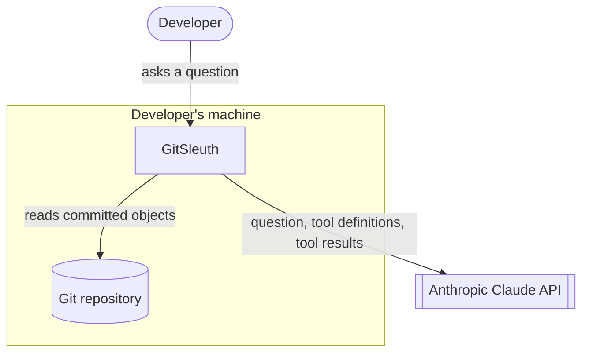
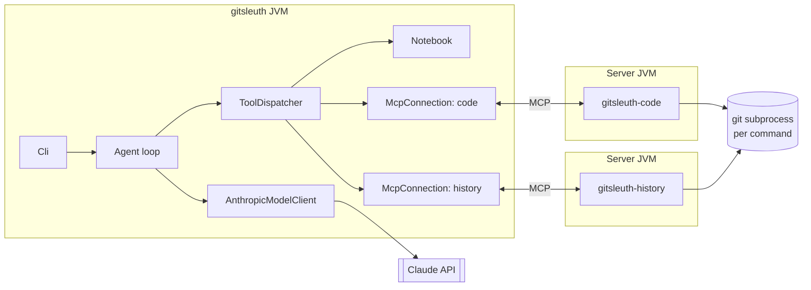

# GitSleuth architecture

## 1. Goals and constraints

| Goal | How the design addresses it |
| --- | --- |
| The agent cannot harm the repository | Every MCP tool is read-only and reads committed git objects. The only writable state is the in-memory notebook |
| A tool failure does not end a run | The dispatcher turns each failure into an error result the model can read and act on |
| Retries do not repeat side effects | A call is retried only if its tool declares `readOnlyHint` or `idempotentHint` |
| A run always ends | Limits on steps, tool calls, tokens and wall-clock time, each with its own stop reason |
| A limit still produces a useful result | Step and tool-call limits allow one last turn without tools, so the model can write up what it found. Findings survive every kind of stop |
| Findings point at real commits | A finding can only cite a hash that appeared in an earlier MCP tool result |
| Testable without spending credits | The loop depends on a small `ModelClient` interface, so tests can script Claude's turns |

## 2. System context

Repository content that the model asks to see is sent to the Claude API. Everything else stays on the machine.

## 3. Containers

By default the client starts each server as a subprocess, using the same JVM and classpath, and talks over stdio. Given `--code-url` and `--history-url`, it connects to running servers over Streamable HTTP instead, served by embedded Jetty. The rest of the system is the same either way.

## 4. Components

### MCP servers

There are two servers built on the official SDK's `McpServer`, so routing between servers is real rather than simulated. Input schemas are written by hand in each server class. Results are Java records, returned both as JSON text and as `structuredContent`, with snake_case field names. No output schemas are declared.

All git access goes through `GitRepo` ([`servers/GitRepo.java`](../src/main/java/dev/gitsleuth/servers/GitRepo.java)), which applies a timeout (20 s) and an output cap (2 MB) to each command. Anticipated failures become results with `isError` set, so the model can read them. An unexpected exception in a tool is logged by the server, and the model sees only `Error executing tool <name>`.

A stdio server halts itself when its parent process exits, so it cannot outlive the client. This has no automated test.

### MCP client

`McpConnection` wraps the SDK's `McpAsyncClient`. It connects, pages through `tools/list`, and exposes `call` and `recover`. The current session is one immutable record, replaced as a whole, so a caller cannot pair one session's client with another session's generation number. When several concurrent calls see the same dead session, that generation number ensures they trigger one reconnect.

The SDK leaves pending requests waiting for their timeout when a stdio server dies, which would make a crash look like a hang. So each stdio session has a watcher on the server process, and a pending call fails as soon as the process exits. [ADR-0004](adr/0004-java-sdk-behaviour.md) has the details.

The client maps failures to the three kinds the dispatcher understands, checking in this order:

| Signal | Mapped to |
| --- | --- |
| No answer within the call's timeout | `ToolTimeoutException` |
| The session has ended, or was replaced by a reconnect | `ConnectionLostException` |
| `McpError` from a live session | `ToolProtocolException` |
| Any other exception from the transport | `ConnectionLostException` |

The tool list is read once, when the toolbox opens. After a reconnect the connection refreshes its own list, but the registry and the definitions sent to the model stay as they were, because a changing tool list would invalidate the prompt cache. If a server drops a tool, calling it returns an error.

### Tool dispatcher

`ToolRegistry` holds every tool as `<server>__<tool>`, rejecting invalid schemas and name collisions when a tool is registered. `ToolDispatcher.dispatch` does not throw for a tool failure. See the [decision diagram](diagrams/dispatch-decisions.md).

| Error kind | Cause | Retried? |
| --- | --- | --- |
| `UNKNOWN_TOOL` | No such tool; the message lists the available ones | No |
| `INVALID_INPUT` | Fails JSON Schema validation; the message lists every problem | No |
| `TOOL_ERROR` | The tool itself reported failure | No |
| `PROTOCOL` | MCP protocol error | No |
| `INTERNAL` | Unexpected exception; details go to the log, not the model | No |
| `TIMEOUT` | No answer within 30 s | If retry-safe |
| `CONNECTION` | Session lost; the session is always reopened | If retry-safe |

Retries use up to 3 attempts with exponential backoff (0.25 s base, 4 s cap, up to 50% jitter). `dispatchMany` runs a turn's calls concurrently on virtual threads, at most 4 at once, and returns outcomes in request order. Results over 60,000 characters are truncated with a marker that says how much was removed.

### Agent loop

The loop in [`Agent.java`](../src/main/java/dev/gitsleuth/Agent.java) is hand-written rather than using the SDK's Tool Runner; [ADR-0002](adr/0002-manual-agent-loop.md) explains why. See the [sequence diagram](diagrams/sequence-agent-run.md).

| Stop reason | Trigger | Final model turn? | Default limit |
| --- | --- | --- | --- |
| `completed` | The model ended its turn | n/a | |
| `step_limit` | The step counter reached the limit | Yes, without tools | 12 model requests |
| `tool_call_limit` | The tool call budget ran out | Yes, without tools | 40 calls |
| `token_limit` | Total tokens over the limit, checked after each turn | No | 1,000,000 |
| `deadline` | Wall-clock limit; interrupts whatever is in flight | No | 600 s |
| `truncated` | `stop_reason: max_tokens`; tool calls in that turn do not run | No | |
| `refused` | `stop_reason: refusal`; tool calls in that turn do not run | No | |
| `model_error` | The API request failed after the SDK's own retries | No | |

The token count adds input, output and cache tokens across all requests. Because it is checked after each turn, a run can pass the limit by up to one turn.

The loop runs on a virtual thread. At the deadline, `run` freezes the result, interrupts that thread and returns, so a slow call cannot hold up the answer or change it afterwards.

A turn with `stop_reason: pause_turn` continues with its content kept in the history. If a turn's calls exceed the remaining budget, the extra calls are answered with an error result, because the API requires a result for every `tool_use` block.

### Model client

`AnthropicModelClient` uses the official SDK's `client.beta().messages().createStreaming`, with `BetaMessageAccumulator` to assemble the final message:

| Setting | Value | Why |
| --- | --- | --- |
| Model | `claude-opus-5-5` | Project default; `--model` overrides it |
| Streaming | `max_tokens` 64,000 | Long turns cannot hit an HTTP timeout |
| Thinking | `adaptive` | |
| Effort | `high` | Set explicitly because this model defaults to `medium`; `--effort` overrides it |
| Prompt caching | Top-level `cache_control` | Each request repeats a growing history |
| Refusal fallback | `fallbacks: "default"` | A declined request can be retried on another model on the server side. The constructor's `useFallbacks` argument turns it off |
| `eager_input_streaming` | Off | See [ADR-0004](adr/0004-java-sdk-behaviour.md) |

Assistant content is sent back unchanged on the next request, as thinking blocks require.

## 5. Reliability

| Failure | Behaviour | Test |
| --- | --- | --- |
| Tool call hangs | Times out; retry-safe tools retry | `ReliabilityTest` |
| Server process exits | Pending calls fail at once; session reopened; retry-safe calls retried | `ReliabilityTest` |
| Server stays down | Attempts run out and the model gets a `connection` error; a later call reconnects | `ReliabilityTest`, `McpHttpTest` |
| Tool with side effects loses its connection | Not retried; the error says the call may or may not have taken effect | `ReliabilityTest` |
| Git hangs or produces huge output | Killed at the timeout or the output cap; a capped result is marked truncated | `ServerToolsTest` |
| Model call hangs | The run's deadline interrupts it | `AgentTest` |
| API failure | The run ends with `model_error`; findings so far are kept | `AgentTest`, `CliTest` |

State lives in memory for one run. There is no resume after the host process itself dies.

## 6. Security

**Threat model.** Repository content is untrusted: a file or commit message can contain text aimed at the model, and repository config can name programs for git to run. The model's tool arguments are untrusted too, because that content can influence them.

| Risk | Mitigation |
| --- | --- |
| Reading secrets outside version control | Tools read committed objects only, so an uncommitted `.env` cannot be read or searched, and error messages do not reveal that it exists |
| Path traversal | Absolute paths, drive letters and `..` are refused. Reads go through `git cat-file`, not the filesystem |
| Git flag injection | Refs must start with a letter or digit and match an allowlist. Refs, paths and patterns are passed after `-e`, `--end-of-options` or `--`, or embedded in a `--flag=value` |
| Repository config running programs | `--no-ext-diff` and `--no-textconv`, plus command-line overrides for `diff.external`, `core.fsmonitor`, `core.hooksPath`, `core.pager` and `protocol.allow`. A test confirms the `diff.external` and textconv traps fire under plain `git show` and not through these tools |
| Prompt injection from repository text | The system prompt marks tool output as data. This is advice to the model, not a guarantee, and it is untested against a real model. The real limit is that no tool can change anything |
| Invented evidence | `record_finding` refuses hashes not seen in an earlier successful MCP result. Any hash-like token in a result counts as seen, so this does not prove the commit exists or that the claim follows from it |
| Sensitive data in logs | Logs record tool names, timings, counts and error messages, not arguments or results |

**Known limits.** Committed secrets can be read and will be sent to the Claude API if the model asks for them. The servers still read the user's global git config. The HTTP transport has no authentication, so it should stay on localhost.

## 7. Scaling and extension

This is a single-user CLI, and no load testing has been done.

- **Adding an MCP server:** open another `McpConnection` in [`Toolbox.java`](../src/main/java/dev/gitsleuth/Toolbox.java) and call `registry.addMcpServer`. Routing, validation and retries then apply with no other changes.
- **Adding a local tool:** implement `ToolBackend`, then register it as `Notebook.register` does.
- **Serving many users:** this would need shared HTTP servers with authentication, per-run state outside the process, and per-repository sandboxing. None of that exists today.
- **Long runs:** there is no context compaction. A run is bounded by its limits rather than by managing the context window.

## 8. Observability

`--verbose` writes one JSON object per event to stderr, including `run_started`, `model_turn` (with token counts), `tool_call` (with attempts, duration and error kind), `tool_retry` (with the reason and error), `mcp_connected`, `mcp_session_failed`, `run_finished`. Events within a run carry its `run_id`, except those from the dispatcher and client, which sit below the run.

## 9. Design decisions

- [ADR-0001: Read committed git objects, not the filesystem](adr/0001-read-git-objects.md)
- [ADR-0002: A hand-written agent loop](adr/0002-manual-agent-loop.md)
- [ADR-0003: Retry only what the server declares safe](adr/0003-retry-safety.md)
- [ADR-0004: Working with the Java SDKs' behaviour](adr/0004-java-sdk-behaviour.md)
