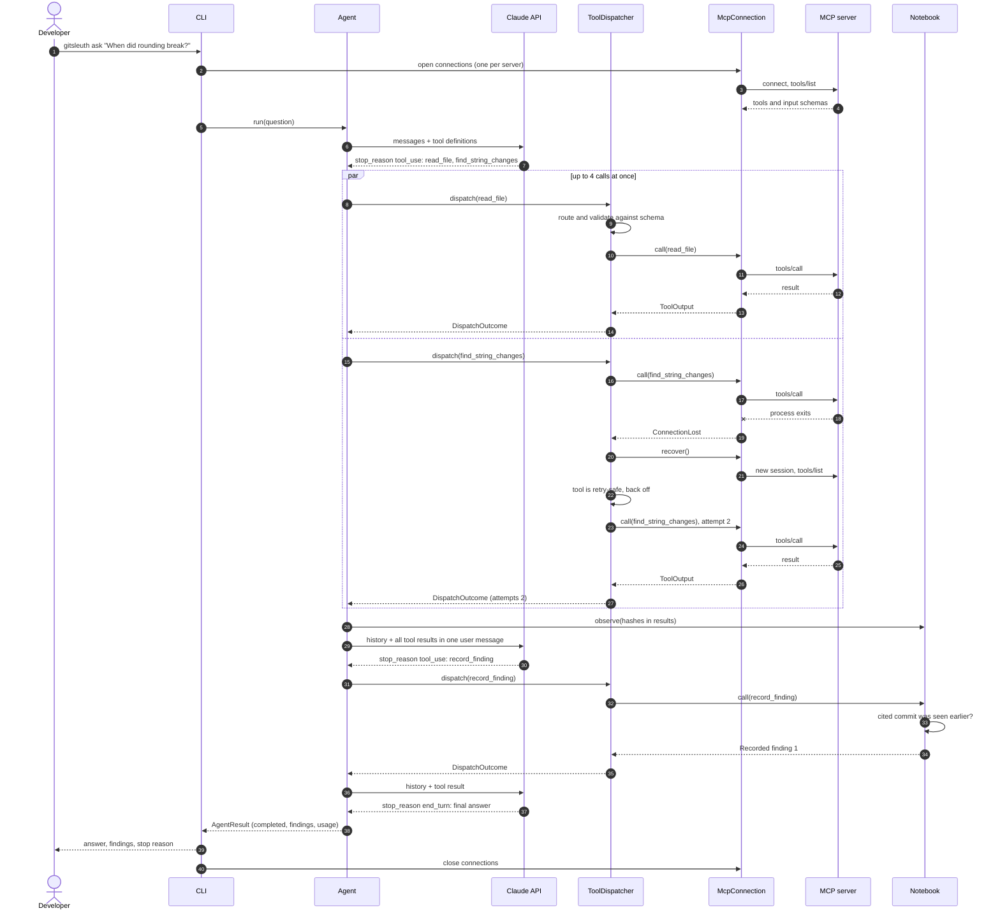

# Sequence: one agent run

One run that hits a crashed server, recovers, records a finding and answers. `AnthropicModelClient` is folded into the Agent's arrow to Claude.

Each pass through the loop first checks the limits. On the last allowed step, or once the tool call budget is spent, the request goes out with `tool_choice: none` so the model can only answer. The deadline covers the whole run and cancels whichever arrow is in flight.
